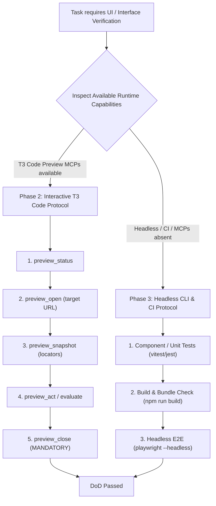

# Interface Testing Protocol — Dual-Runtime Adaptive Guidelines

Ensures deterministic, environment-aware verification of graphical and web user interfaces without causing runtime hangs, orphaned preview sessions, or blocked agent execution.

## 1. Architectural Overview & Dual-Runtime Model

Agents operating across `ye-sandbox` execute in heterogeneous runtimes:
1. **Interactive T3 Code Environment:** Equipped with specialized preview and device Model Context Protocol (MCP) servers (`preview_*`, `device_*`, `html_*`).
2. **Headless CLI / CI Environment:** Standard terminal shells, GitHub Actions runners, or background container sandboxes lacking GUI servers.

The agent MUST adaptively inspect its available capabilities and execute the corresponding protocol path:



---

## 2. Phase 1: Runtime Capability Probing

Before executing interface actions, verify environment capabilities:

```bash
# Verify whether interactive preview tools or display capabilities exist
echo "TERM: ${TERM:-}, CI: ${CI:-}, DISPLAY: ${DISPLAY:-}"
```

- If `preview_open` and `preview_status` are declared in the agent's MCP toolset: **Route to Phase 2**.
- If `preview_*` tools are unavailable or running in a headless CI container: **Route to Phase 3**.

---

## 3. Phase 2: Interactive T3 Code Protocol

### Web & Frontend Preview Lifecycle

When verifying web applications, pages, or components inside T3 Code:

1. **Probe Preview Status:**
   - Always call `preview_status` first to check if a tab or preview instance is already active.
   - Avoid creating duplicate tabs for the same URL target.

2. **Open Preview Session:**
   - Call `preview_open` with the local or tunnel URL (e.g. `http://localhost:3000`).
   - If the local server is not running, launch it in the background on an ephemeral port.

3. **DOM & Accessibility Snapshot:**
   - Call `preview_snapshot` to retrieve accessibility trees, interactive element IDs, and semantic `@ref` locators.
   - **Locator Priority:** Always prefer semantic snapshot references (`@ref:button_submit`, accessibility role locators) over raw $(x, y)$ coordinate clicks.

4. **Interactive Action & State Mutation:**
   - Call `preview_act` to perform clicks, text inputs, form submissions, or scrolling.
   - Take a new snapshot after actions that trigger state transitions, modals, or page navigation.

5. **Console & Error Evaluation:**
   - Call `preview_evaluate` to assert absence of uncaught console errors, rejected promises, or broken CSS layouts.

6. **Mandatory Teardown (Invariant 7.3):**
   - Call `preview_close` immediately after verification succeeds.
   - NEVER hand back control to the user or mark a task complete with lingering preview tabs open.

### Mobile & Device Protocol

When testing mobile interfaces or Android emulators:
1. Enumerate available targets via `device_list`.
2. Open target emulator session using `device_open`.
3. Capture screen rendering with `device_screenshot`.
4. Close device connection cleanly via `device_close`.

---

## 4. Phase 3: Headless CLI & CI Runner Protocol

When interactive MCP tools are not available (e.g. Linux workstation shell, SSH, Docker container, GitHub Actions CI):

1. **Non-Blocking Component & Unit Tests:**
   - Execute headless component assertions:
     ```bash
     npm test -- --run
     # or: npx vitest run
     ```

2. **Compiler & Bundler Verification:**
   - Run typechecking and static asset builds to guarantee zero syntax or bundling regressions:
     ```bash
     npm run build
     # or: npx svelte-check / tsc --noEmit
     ```

3. **Headless Browser Assertions (Optional E2E):**
   - If Playwright or Puppeteer are installed in the workspace, run exclusively in headless mode:
     ```bash
     npx playwright test --reporter=list
     ```

4. **Ephemeral Dev Server Management:**
   - If a running server is required for headless curl or integration tests:
     ```bash
     # Launch in background, probe readiness, execute tests, terminate
     PORT=3100 npm run preview &
     SERVER_PID=$!
     trap 'kill "$SERVER_PID" 2>/dev/null || true' EXIT
     curl -fsS --retry 5 --retry-connrefused http://127.0.0.1:3100 >/dev/null
     ```

---

## 5. Invariants & Anti-Patterns

| Anti-Pattern | Violation Class | Correct Pattern |
| :--- | :--- | :--- |
| Calling `preview_open` during headless CI | `[P1]` Runtime Hang | Probe capabilities; execute `npm run build` and headless tests. |
| Using `preview_open` to read web docs | `[P1]` Resource Waste (Inv 7.2) | Use headless `read_url_content` or `search_web`. |
| Leaving preview tabs open at task end | `[P1]` Leakage (Inv 7.3) | Always execute `preview_close` prior to marking task complete. |
| Blocking foreground with `npm run dev` | `[P2]` Process Deadlock | Use background tasks with readiness polling and clean termination traps. |
| Clicking coordinates without snapshot | `[P2]` Flaky Interaction | Call `preview_snapshot` first and use semantic element locators. |
