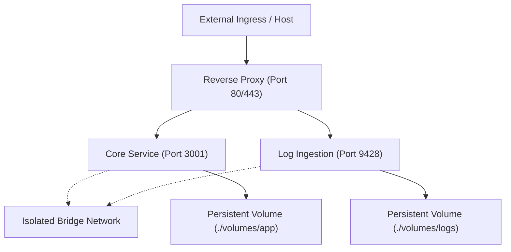

# Infra Starter Kit

Technical framework for service orchestration, Docker Compose stacks, and Homelab infrastructure with AI coding agents.

**[English](README.md)** | **[Português (Brasil)](README.pt-br.md)**

[](https://github.com/ye-sandbox/template-agent/actions)
[]()
[](LICENSE)

---

## Overview

The Infra starter kit provides an engineering governance harness for AI coding agents (Antigravity, Claude Code, Cursor, Windsurf, Roo Code, Aider) managing and orchestrating infrastructure services, Docker Compose stacks, and Homelab environments (observability, databases, message brokers, reverse proxies).

Operating AI agents on infrastructure introduces significant risks: port binding collisions, plaintext secrets in YAML, memory leaks, and accidental persistent volume loss. The Infra starter mitigates these hazards through:
- **Service Topology Contract:** Centralized registry of host ports, volume mounts, networks, and healthchecks in `.agent/SERVICES.md`.
- **Standardized Service Playbook:** Reusable procedural directives in `.agent/skills/compose-service/SKILL.md` enforcing resource boundaries and non-root execution.
- **Volume Protection:** Persistent datastores mapped to `./volumes` with strict gitignore rules and guardrails against destructive volume purges.
- **Secret Isolation:** Environment substitution via `.env.example` preventing plaintext passwords from appearing in git history.

## Architecture



### Directory Structure

```text
├── AGENTS.md                    # SRE golden rules and infrastructure guardrails
├── init.sh                      # Scaffolding script for new infrastructure repositories
├── compose.yaml.example         # Canonical Compose specification with healthchecks and limits
├── .env.example                 # Environment variable and port mapping contracts
├── .gitignore                   # Guards against committing volumes, data, and secret files
├── docs/
│   ├── README.md                # Infrastructure architecture runbooks index
│   └── adr/decisions.md         # Consolidated Architectural Decision Records
└── .agent/
    ├── SERVICES.md              # Living topology: Ports, Volumes, Networks, Healthchecks
    ├── TASK.md                  # Active task and service evolution roadmap
    ├── NOTES.md                 # Infrastructure architectural decisions and gotchas
    ├── ARCHIVE.md               # Completed task history preserving lean context
    ├── knowledge/               # Modular runtime gotchas and platform cards
    │   ├── 000-schema.md        # Knowledge card specification
    │   └── k-000-template.md    # Template for runtime cards
    └── skills/
        └── compose-service/     # Standard procedure for provisioning services
            └── SKILL.md         # Step-by-step Compose service playbook
```

## Quickstart

### Prerequisites

- Docker Engine 24.0+ and Docker Compose v2.20+
- Git 2.30+
- Bash 4.0+
- `curl` 7.60+

### Scaffolding a New Infrastructure Repository

Initialize a clean infrastructure repository via the automated one-liner:

```bash
curl -fsSL https://raw.githubusercontent.com/ye-sandbox/template-agent/infra/init.sh | bash -s -- my-homelab
cd my-homelab
```

*Alternative via manual Git clone:*

```bash
git clone --depth 1 -b infra https://github.com/ye-sandbox/template-agent.git my-homelab
cd my-homelab
rm -rf .git && git init -b main && git add . && git commit -m "chore: initial setup"
```

### Setup & Local Launch

```bash
# 1. Configure environment variables
cp .env.example .env

# 2. Initialize Compose specification from canonical example
cp compose.yaml.example compose.yaml

# 3. Validate syntax and interpolated variables
docker compose config --quiet && echo "Compose syntax valid!"

# 4. Launch services in detached mode
docker compose up -d
docker compose ps
```

### Kickoff Prompt

Provide this prompt to your AI coding agent during the initial turn:

> "Read AGENTS.md, .agent/SERVICES.md, .agent/TASK.md, and .agent/skills/compose-service/SKILL.md. Present your plan for Task [00.1] Baseline Service Provisioning before altering configuration files."

## Configuration

The template provides canonical configuration schemas via `.env.example`:

| Variable | Description | Default | Required |
| :--- | :--- | :--- | :--- |
| `TZ` | Container runtime timezone setting | `America/Sao_Paulo` | No |
| `DATA_PATH` | Host root directory path for local data volume persistence | `./volumes` | Yes |
| `VICTORIALOGS_PORT` | Listening host port for VictoriaLogs ingestion service | `9428` | No |
| `UPTIME_KUMA_PORT` | Listening host port for Uptime Kuma monitoring service | `3001` | No |
| `REVERSE_PROXY_HTTP_PORT` | Listening host port for HTTP reverse proxy ingress | `80` | No |
| `REVERSE_PROXY_HTTPS_PORT` | Listening host port for HTTPS reverse proxy ingress | `443` | No |
| `ADMIN_PASSWORD` | Administrative service password placeholder | `change_this_password_in_production` | Yes (in production) |
| `API_SECRET_TOKEN` | Service integration cryptographic token placeholder | `generate_a_random_token_here` | Yes (in production) |

## Usage

### Infrastructure Invariants & Operational Rules

1. **Topology First:** Record all exposed ports, mounts, and networks in `.agent/SERVICES.md` before editing `compose.yaml`.
2. **Mandatory Healthchecks:** Every service declaration must include a functional healthcheck (`test`, `interval`, `timeout`, `retries`).
3. **Resource Boundaries:** Define explicit memory and CPU limits (`deploy.resources.limits`) on all service declarations.
4. **Volume Protection:** Never execute `docker compose down -v` without explicit, confirmed human instruction.
5. **Secret Hygiene:** Passwords, tokens, and private keys reside exclusively in `.env`.

## Development

### Validation Commands

```bash
# Validate Compose configuration syntax
docker compose config --quiet

# Verify repository formatting and whitespace integrity
git diff --check
```

## License

Released under the [MIT License](LICENSE).
