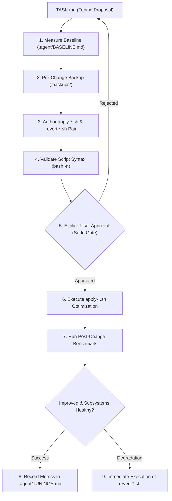

# Baremetal Starter Kit

Technical framework for host administration, workstation tuning, and OS performance with AI coding agents.

**[English](README.md)** | **[Português (Brasil)](README.pt-br.md)**

[](https://github.com/ye-sandbox/template-agent/actions)
[]()
[](LICENSE)

---

## Overview

The Baremetal starter kit provides an engineering governance harness for AI coding agents (Antigravity, Claude Code, Cursor, Windsurf, Roo Code, Aider) operating directly on host operating systems, developer workstations, and bare-metal servers (kernel parameters, sysctl, systemd services, CPU governors, storage schedulers, and dotfiles).

Executing autonomous agents on bare-metal systems carries high operational risk: bricked networking, unresponsive display managers, audio server degradation, or unrecoverable `/etc` edits. The Baremetal starter enforces strict safeguards:
- **Rollback-First Invariant:** Every system modification requires a pre-change backup in `.backups/` and a validated symmetrical `revert-<name>.sh` script before applying changes.
- **System Baseline Inventory:** Hardware topology, kernel version, storage block devices, and baseline performance metrics are recorded in `.agent/BASELINE.md`.
- **Tunings Audit Registry:** Canonical log of all applied, pending, and reverted optimizations with quantifiable before-and-after benchmarks in `.agent/TUNINGS.md`.
- **Host Subsystem Guardrails:** Critical subsystems (networking, display manager, PipeWire/audio, bootloader, SSH) are declared inviolable in `.agent/INVARIANTS.md`.

## Architecture



### Directory Structure

```text
├── AGENTS.md                    # System administration constitution (rollback-first, non-destructive)
├── init.sh                      # Scaffolding script for new workstation repositories
├── .env.example                 # Environment schema for telemetry, logging, and benchmarking
├── .gitignore                   # Guards against committing telemetry dumps, backups, and logs
├── benchmarks/
│   ├── README.md                # Benchmarking guidelines and methodology
│   └── scripts/                 # CPU, I/O, latency, and thermal monitoring scripts
├── docs/adr/decisions.md         # Consolidated Architectural Decision Records
├── tests/
│   └── smoke.sh                 # Smoke test suite asserting host contracts and invariants
└── .agent/
    ├── BASELINE.md              # Hardware specs, OS release, and baseline performance
    ├── INVARIANTS.md            # Inviolable subsystems (display, audio, networking)
    ├── TUNINGS.md               # Canonical registry of applied optimizations and metrics
    ├── TASK.md                  # Active tuning task and operational roadmap
    ├── NOTES.md                 # System architecture decisions and runtime gotchas
    ├── ARCHIVE.md               # Completed tuning history preserving lean context
    ├── knowledge/               # Modular runtime gotchas and platform cards
    │   ├── 000-schema.md        # Knowledge card specification
    │   └── k-000-template.md    # Template for runtime cards
    └── skills/
        └── baremetal-tuning/    # Standard operating procedure for authoring tunings
            └── SKILL.md         # Step-by-step baremetal tuning playbook
```

## Quickstart

### Prerequisites

- Linux OS (Kernel 5.15+ / 6.x+)
- Bash 5.0+
- Git 2.30+
- `curl` 7.60+

### Scaffolding a New Workstation Repository

Initialize a clean workstation ops repository via the automated one-liner:

```bash
curl -fsSL https://raw.githubusercontent.com/ye-sandbox/template-agent/baremetal/init.sh | bash -s -- my-workstation-ops
cd my-workstation-ops
```

*Alternative via manual Git clone:*

```bash
git clone --depth 1 -b baremetal https://github.com/ye-sandbox/template-agent.git my-workstation-ops
cd my-workstation-ops
rm -rf .git && git init -b main && git add . && git commit -m "chore: initial setup"
```

### Kickoff Prompt

Provide this prompt to your AI coding agent during the initial discovery phase:

> "Read AGENTS.md, .agent/BASELINE.md, .agent/INVARIANTS.md, and .agent/skills/baremetal-tuning/SKILL.md. Present your implementation plan for Task [00.1] Baseline System Audit & Performance Discovery before running any modification or privileged commands."

## Configuration

The template provides canonical configuration schemas via `.env.example`:

| Variable | Description | Default | Required |
| :--- | :--- | :--- | :--- |
| `VECTOR_ENABLED` | Toggle background ingestion of benchmark telemetry to Vector | `false` | No |
| `VECTOR_HOST` | Host address of local or network Vector collector | `127.0.0.1` | No |
| `VECTOR_HTTP_PORT` | HTTP port for Vector NDJSON log ingestion endpoint | `8686` | No |
| `SERVICE_NAME` | Service identifier label attached to emitted telemetry | `baremetal-workstation` | No |
| `ENV` | Environment classification tag (`production`, `development`) | `production` | No |
| `BENCHMARK_TOOL` | Preferred benchmarking suite utility (`sysbench`, `fio`, `custom`) | `sysbench` | No |

## Usage

### Baremetal Operational Invariants

1. **Rollback-First:** NEVER modify `/etc`, kernel parameters, or system units without a verified backup in `.backups/` and a tested `revert-<name>.sh` script.
2. **Explicit Sudo Confirmation:** Autonomous execution of privileged commands is strictly forbidden. The agent must present the exact command and rationale for human approval.
3. **Progressive Tuning:** Apply only ONE optimization at a time. Measure baseline metrics before and after applying changes.
4. **Protect Critical Invariants:** Verify that network connectivity, audio servers (PipeWire), and display managers remain completely unaffected after each tuning.

## Development

### Validation Commands

```bash
# Execute local host contract smoke test suite
./tests/smoke.sh

# Verify repository formatting and whitespace integrity
git diff --check
```

## License

Released under the [MIT License](LICENSE).
