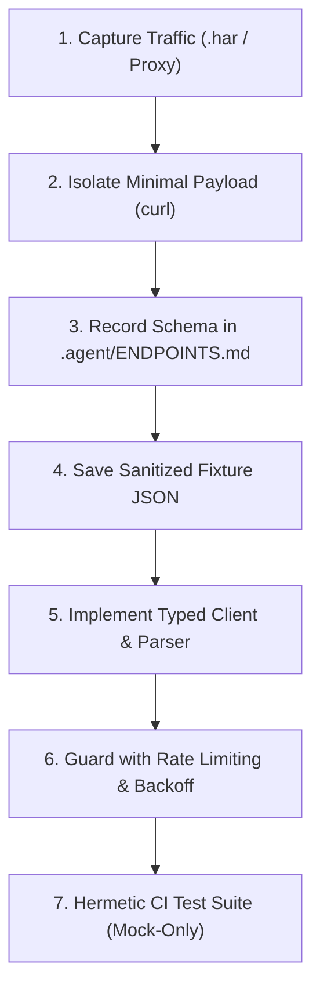

# Blackbox Starter Kit

Technical framework for reverse engineering, undocumented APIs, and scrapers with AI coding agents.

**[English](README.md)** | **[Português (Brasil)](README.pt-br.md)**

[](https://github.com/ye-sandbox/template-agent/actions)
[]()
[](LICENSE)

---

## Overview

The Blackbox starter kit provides a structured engineering harness for AI coding agents (Antigravity, Claude Code, Cursor, Windsurf, Roo Code, Aider) operating against target systems that lack public documentation or official APIs (such as legacy ERPs, closed enterprise portals, and undocumented mobile backends).

Autonomous agents often fail in reverse engineering workflows through hallucinated payload schemas, expired session handling, or making live requests during automated builds. The Blackbox starter resolves these failure modes with:
- **Route Discovery Catalog:** Centralized inventory of endpoints, request headers, cookies, and hidden form fields in `.agent/ENDPOINTS.md`.
- **Fixtures-First Standard:** Mandatory recording of sanitized offline mock fixtures before authoring production client code to ensure hermetic CI.
- **Defensive Transport Layer:** Pacing delays, rate-limiting, and exponential backoff to avoid IP throttling and anti-scraping bans.
- **Six-Step Reverse Engineering Playbook:** Systematic protocol (`Capture` $\rightarrow$ `Isolation` $\rightarrow$ `Minimization` $\rightarrow$ `Catalog` $\rightarrow$ `Fixtures` $\rightarrow$ `Typed Client`) documented in `.agent/skills/reverse-engineering/SKILL.md`.

## Architecture



### Directory Structure

```text
├── AGENTS.md                        # Constitution for reverse engineering (anti-ban, fixtures-first)
├── init.sh                          # Scaffolding script for new blackbox repositories
├── .env.example                     # Environment schema for targets, credentials, and tuning
├── .gitignore                       # Ignores .env, *.har, *.pcap, and raw session dumps
├── docs/adr/decisions.md            # Architectural Decision Records (ADR log)
└── .agent/
    ├── ENDPOINTS.md                 # Living catalog of discovered routes, payloads, and cookies
    ├── TASK.md                      # Roadmap and active agent task
    ├── NOTES.md                     # Target system invariants, quirks, and gotchas
    ├── ARCHIVE.md                   # Completed task history preserving lean context
    ├── knowledge/                   # Modular runtime gotchas and platform cards
    │   ├── 000-schema.md            # Knowledge card specification
    │   └── k-000-template.md        # Template for runtime cards
    └── skills/
        └── reverse-engineering/
            └── SKILL.md             # Step-by-step reverse engineering protocol
```

## Quickstart

### Prerequisites

- Git 2.30+
- Bash 4.0+
- `curl` 7.60+

### Scaffolding a New Blackbox Project

Initialize a clean blackbox project via the automated one-liner:

```bash
curl -fsSL https://raw.githubusercontent.com/ye-sandbox/template-agent/blackbox/init.sh | bash -s -- my-blackbox-project
cd my-blackbox-project
```

*Alternative via manual Git clone:*

```bash
git clone --depth 1 -b blackbox https://github.com/ye-sandbox/template-agent.git my-blackbox-project
cd my-blackbox-project
rm -rf .git && git init -b main && git add . && git commit -m "chore: initial setup"
```

### Kickoff Prompt

Provide this prompt to your AI coding agent during the initial discovery phase:

> "Read AGENTS.md, .agent/TASK.md, .agent/ENDPOINTS.md, and .agent/skills/reverse-engineering/SKILL.md. Present your plan for Task [00.1] Authentication Discovery before running live requests."

## Configuration

The template provides canonical configuration schemas via `.env.example`:

| Variable | Description | Default | Required |
| :--- | :--- | :--- | :--- |
| `TARGET_BASE_URL` | Base HTTP/HTTPS URL of the target system or API gateway | `https://legacy-portal.example.com/api` | Yes |
| `TARGET_USERNAME` | Service or user identifier for authentication workflows | `example_user` | No |
| `TARGET_PASSWORD` | Service or user secret for authentication workflows | `secure_password_here` | No |
| `TARGET_SESSION_COOKIE` | Manual session cookie for rapid probing and scratch testing | — | No |
| `TARGET_CSRF_HASH` | Anti-CSRF token or dynamic state parameter | — | No |
| `HTTP_TIMEOUT_SECONDS` | Maximum network timeout in seconds for outbound HTTP requests | `30` | No |
| `HTTP_MAX_RETRIES` | Maximum retry attempts on transient network errors or 5xx codes | `3` | No |
| `REQUEST_DELAY_MS` | Concurrency throttle delay in milliseconds between requests | `500` | No |
| `PROXY_URL` | Optional HTTP/SOCKS5 proxy endpoint for traffic routing | — | No |
| `USER_AGENT` | Standard client fingerprint header | `Mozilla/5.0 ... Chrome/124.0.0.0` | No |

## Usage

### Golden Rules for Blackbox Engineering

1. **Verify Before Coding:** Always isolate a minimal working `curl` invocation before writing production client or scraper logic.
2. **Catalog First:** No route enters application source without prior documentation in `.agent/ENDPOINTS.md`.
3. **Mocked Test Fixtures:** Automated CI suites must never execute live external requests. All tests run against saved fixtures.
4. **Target System Protection:** Enforce request delays, concurrency boundaries, and exponential backoff to avoid service degradation.
5. **Credential Isolation:** Passwords, tokens, and active cookies remain strictly in `.env` and are never committed.

## Development

### Validation Commands

```bash
# Verify repository formatting and whitespace integrity
git diff --check
```

## License

Released under the [MIT License](LICENSE).
