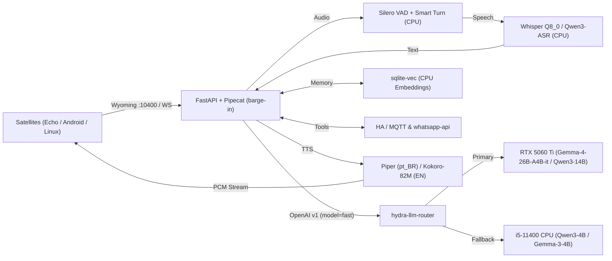

# offgrid-voice

Local-first, zero-VRAM-contention voice assistant server built with FastAPI, Pipecat, and the Wyoming protocol for the `ye-sandbox` homelab.

**[English](README.md)** | **[Português (Brasil)](README.pt-br.md)**

[]()
[]()

---

## Overview

`offgrid-voice` runs all audio processing (VAD, turn detection, STT, TTS) and vector memory on CPU (`0 MB` GPU VRAM contention) on a 24/7 `i5-11400` (`32 GB RAM`) Mini PC, while routing LLM inference through [`hydra-llm-router`](.agent/ECOSYSTEM.md) (`fast` virtual model alias) with automatic GPU-to-CPU failover.

- **Zero VRAM Contention:** `Silero VAD` + `Smart Turn`, `whisper-large-v3-turbo` (`Q8_0` / `INT8` AVX-512) or `Qwen3-ASR-1.7B-gguf`, `Piper TTS` (`pt_BR-faber-medium`, `< 100ms` latency), `Kokoro-82M`, and `sqlite-vec` (`bge-m3` / `Qwen3-Embedding-0.6B`) execute strictly on CPU.
- **Automatic LLM Failover:** Consumes `hydra-llm-router` (`fast` alias) backed by `local-llm-worker` (`RTX 5060 Ti 16 GB`: `Gemma-4-26B-A4B-it` / `Qwen3-14B`, thinking disabled) with automatic CPU fallback (`Qwen3-4B` / `Gemma-3-4B`) when the workstation is busy or powered off.
- **Modular Tools & Satellites:** Supports `Wyoming` (`TCP :10400`) and `FastAPI` WebSocket (`/ws/voice`) with `barge-in` for jailbroken Echo satellites (`amonet 2` / `Firebreak`), Android Kiosk / Linux clients, `whatsapp-api`, and Home Assistant / MQTT.

## Architecture

See [docs/architecture/voice-pipeline.md](docs/architecture/voice-pipeline.md) for the full pipeline specification.



## Quickstart

Prerequisites: Python `3.12+` and `uv`.

```bash
cp .env.example .env
uv sync
uv run pytest
```

## Configuration

| Variable | Description | Default | Required |
| :--- | :--- | :--- | :--- |
| `APP_ENV` | Runtime environment mode | `development` | No |
| `APP_PORT` | FastAPI HTTP / WebSocket port | `8000` | No |
| `WYOMING_PORT` | Wyoming protocol TCP listener port | `10400` | No |
| `APP_SECRET_KEY` | Application session secret | `change-me-in-production` | Yes |
| `SQLITE_VEC_PATH` | Path to `sqlite-vec` memory database | `./data/offgrid_memory.db` | No |
| `EMBEDDING_MODEL` | CPU embedding model (`bge-m3` / `Qwen3-Embedding-0.6B`) | `Qwen3-Embedding-0.6B` | No |
| `STT_MODEL` | CPU STT model (`whisper-large-v3-turbo` / `Qwen3-ASR-1.7B-gguf`) | `whisper-large-v3-turbo` | No |
| `STT_QUANTIZATION` | STT quantization level (`Q8_0` / `INT8`) | `Q8_0` | No |
| `TTS_VOICE_PT_BR` | Piper PT-BR voice model | `pt_BR-faber-medium` | No |
| `TTS_VOICE_EN` | English TTS model | `kokoro-82m` | No |
| `LLM_BASE_URL` | `hydra-llm-router` OpenAI v1 base URL | `http://hydra-llm-router:3000/v1` | Yes |
| `LLM_API_KEY` | Hydra tier API key | `sk-replace-with-hydra-tier-token` | Yes |
| `LLM_MODEL_FAST` | Low-latency virtual model alias | `fast` | No |
| `LLM_MODEL_DEEP` | Deep reasoning virtual model alias | `deep` | No |
| `LLM_TIMEOUT_SECONDS` | HTTP client timeout in seconds | `180` | No |
| `WHATSAPP_API_URL` | Gatekeeper `whatsapp-api` base URL | `http://whatsapp-api:3000` | No |
| `WHATSAPP_API_KEY` | `x-api-key` for `whatsapp-api` | `replace-with-whatsapp-api-key` | No |
| `MQTT_BROKER_URL` | Local MQTT broker URL | `mqtt://localhost:1883` | No |
| `HA_URL` | Home Assistant base URL | `http://homeassistant.local:8123` | No |
| `HA_TOKEN` | Home Assistant long-lived access token | `replace-with-ha-long-lived-token` | No |

## Usage

Endpoints and protocols planned for Phase 1–2 (see [.agent/TASK.md](.agent/TASK.md)):

- `GET /health` — Healthcheck endpoint (HTTP 200 access logs suppressed).
- `TCP :10400` — Wyoming protocol server for audio satellites.
- `WS /ws/voice` — Streaming WebSocket endpoint for `View Assist` / Android Kiosk clients.

## Development

```text
offgrid-voice/
├── .agent/                 # Governance, TASK.md roadmap, NOTES.md contracts, ECOSYSTEM.md
├── docs/
│   ├── adr/                # Architectural decision diary (decisions.md)
│   └── architecture/       # Voice pipeline specification (voice-pipeline.md)
├── .env.example            # Environment variable contract
└── AGENTS.md               # Engineering rules and validation commands
```

Validation commands:

```bash
uv run pytest
uv run ruff check . && uv run ruff format --check .
uv run mypy src tests
git diff --check
```

## License

Private / Internal (`ye-sandbox` homelab).
