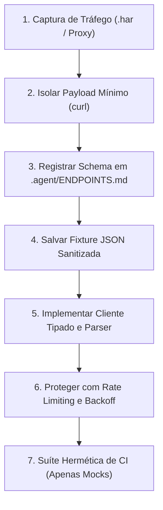

# Blackbox Starter Kit

Framework técnico para engenharia reversa, APIs não documentadas e scrapers com agentes de IA.

**[English](README.md)** | **[Português (Brasil)](README.pt-br.md)**

[](https://github.com/ye-sandbox/template-agent/actions)
[]()
[](LICENSE)

---

## Visão Geral

O starter kit Blackbox fornece uma estrutura técnica para orientar agentes de codificação por IA (Antigravity, Claude Code, Cursor, Windsurf, Roo Code, Aider) no mapeamento e integração de sistemas que não possuem documentação oficial ou APIs públicas (como ERPs legados, portais corporativos internos e backends móveis fechados).

Agentes autônomos costumam falhar em fluxos de engenharia reversa por alucinar nomes de parâmetros, ignorar expiração de sessões ou disparar chamadas reais de rede durante testes em CI. O starter Blackbox resolve essas falhas com:
- **Catálogo de Descoberta de Rotas:** Inventário centralizado de endpoints, cabeçalhos, cookies e campos ocultos em `.agent/ENDPOINTS.md`.
- **Padrão Fixtures-First:** Gravação obrigatória de fixtures de resposta mockadas e sanitizadas antes de codificar o cliente de produção.
- **Camada de Transporte Defensiva:** Delays de cadência, rate-limiting e backoff exponencial para evitar bloqueios de IP e defesas anti-scraping.
- **Metodologia de 6 Passos:** Protocolo sistemático (`Captura` $\rightarrow$ `Isolamento` $\rightarrow$ `Minimização` $\rightarrow$ `Catálogo` $\rightarrow$ `Fixtures` $\rightarrow$ `Cliente Tipado`) documentado em `.agent/skills/reverse-engineering/SKILL.md`.

## Arquitetura



### Estrutura de Diretórios

```text
├── AGENTS.md                        # Constituição para engenharia reversa (anti-ban, fixtures-first)
├── init.sh                          # Script de scaffolding para novos projetos blackbox
├── .env.example                     # Esquema de variáveis para alvos, credenciais e tuning
├── .gitignore                       # Ignora .env, *.har, *.pcap e dumps de sessão
├── docs/adr/decisions.md            # Registros de Decisões de Arquitetura (log de ADRs)
└── .agent/
    ├── ENDPOINTS.md                 # Catálogo vivo de rotas descobertas, payloads e cookies
    ├── TASK.md                      # Roadmap e tarefa ativa do agente
    ├── NOTES.md                     # Invariantes, peculiaridades e gotchas do sistema-alvo
    ├── ARCHIVE.md                   # Histórico de tarefas concluídas
    ├── knowledge/                   # Cards modulares de gotchas e armadilhas de runtime
    │   ├── 000-schema.md            # Especificação do schema de knowledge cards
    │   └── k-000-template.md        # Template para novos knowledge cards
    └── skills/
        └── reverse-engineering/
            └── SKILL.md             # Protocolo passo a passo de engenharia reversa
```

## Início Rápido

### Pré-requisitos

- Git 2.30+
- Bash 4.0+
- `curl` 7.60+

### Criando um Novo Projeto Blackbox

Inicialize um novo repositório via script automatizado:

```bash
curl -fsSL https://raw.githubusercontent.com/ye-sandbox/template-agent/blackbox/init.sh | bash -s -- meu-projeto-blackbox
cd meu-projeto-blackbox
```

*Alternativa via clone manual do Git:*

```bash
git clone --depth 1 -b blackbox https://github.com/ye-sandbox/template-agent.git meu-projeto-blackbox
cd meu-projeto-blackbox
rm -rf .git && git init -b main && git add . && git commit -m "chore: initial setup"
```

### Prompt Inicial

Envie este prompt ao seu agente de codificação durante a fase de descoberta:

> "Leia AGENTS.md, .agent/TASK.md, .agent/ENDPOINTS.md e a skill em .agent/skills/reverse-engineering/SKILL.md. Apresente seu plano para a Tarefa [00.1] Descoberta de Autenticação antes de executar requisições ativas."

## Configuração

O template fornece esquemas de configuração padronizados através do `.env.example`:

| Variável | Descrição | Padrão | Obrigatório |
| :--- | :--- | :--- | :--- |
| `TARGET_BASE_URL` | URL base HTTP/HTTPS do sistema-alvo ou gateway da API | `https://legacy-portal.example.com/api` | Sim |
| `TARGET_USERNAME` | Identificador de usuário para fluxos de autenticação | `example_user` | Não |
| `TARGET_PASSWORD` | Senha ou segredo para fluxos de autenticação | `secure_password_here` | Não |
| `TARGET_SESSION_COOKIE` | Cookie de sessão manual para sondagens rápidas via cURL | — | Não |
| `TARGET_CSRF_HASH` | Token anti-CSRF ou parâmetro dinâmico de estado | — | Não |
| `HTTP_TIMEOUT_SECONDS` | Timeout de rede em segundos para requisições externas | `30` | Não |
| `HTTP_MAX_RETRIES` | Número máximo de retentativas em falhas transitórias de rede | `3` | Não |
| `REQUEST_DELAY_MS` | Atraso em milissegundos entre requisições consecutivas | `500` | Não |
| `PROXY_URL` | Endpoint de proxy HTTP/SOCKS5 opcional para tráfego | — | Não |
| `USER_AGENT` | Header de fingerprint do cliente HTTP | `Mozilla/5.0 ... Chrome/124.0.0.0` | Não |

## Uso

### Regras Fundamentais para Engenharia Reversa

1. **Inspecione Antes de Codificar:** Sempre isole uma chamada `curl` mínima funcional antes de implementar o cliente final.
2. **Catálogo Primeiro:** Nenhuma rota entra no código da aplicação sem estar documentada em `.agent/ENDPOINTS.md`.
3. **Fixtures Mockadas para Testes:** Suítes de CI nunca disparam requisições externas reais. Todos os testes rodam contra fixtures estáticas.
4. **Proteção do Sistema-Alvo:** Aplique intervalos de espera, controle de concorrência e backoff exponencial para evitar bloqueios.
5. **Segurança de Credenciais:** Senhas, tokens e cookies de sessão permanecem estritamente no `.env` e nunca entram no Git.

## Desenvolvimento

### Comandos de Validação

```bash
# Verificar integridade de formatação e espaços em branco
git diff --check
```

## Licença

Distribuído sob a licença [MIT](LICENSE).
