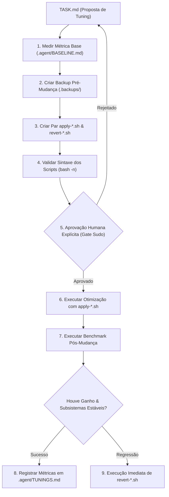

# Baremetal Starter Kit

Framework técnico para administração de host, tuning de workstation e performance de SO com agentes de IA.

**[English](README.md)** | **[Português (Brasil)](README.pt-br.md)**

[](https://github.com/ye-sandbox/template-agent/actions)
[]()
[](LICENSE)

---

## Visão Geral

O starter kit Baremetal fornece uma estrutura de governança de engenharia para orientar agentes de codificação por IA (Antigravity, Claude Code, Cursor, Windsurf, Roo Code, Aider) atuando diretamente no sistema operacional do host, estações de trabalho e servidores bare-metal (parâmetros de kernel, sysctl, serviços systemd, governors de CPU, schedulers de I/O e dotfiles).

Executar agentes autônomos diretamente no sistema operacional do host envolve riscos críticos: quebra de rede, instabilidade do display manager, regressões no servidor de áudio ou alterações irreversíveis em `/etc`. O starter Baremetal impõe salvaguardas rigorosas:
- **Invariante Rollback-First:** Toda modificação exige criação prévia de backup em `.backups/` e script simétrico de reversão `revert-<name>.sh` devidamente testado antes da aplicação.
- **Inventário de Baseline:** Especificações de hardware, versão do kernel, topologia de armazenamento e métricas de desempenho base registradas em `.agent/BASELINE.md`.
- **Registro Canônico de Otimizações:** Registro auditável de todas as modificações aplicadas, pendentes ou revertidas com métricas comparativas em `.agent/TUNINGS.md`.
- **Proteção de Subsistemas Críticos:** Subsistemas vitais (rede, servidor gráfico, PipeWire/áudio, bootloader, SSH) são declarados invioláveis em `.agent/INVARIANTS.md`.

## Arquitetura



### Estrutura de Diretórios

```text
├── AGENTS.md                    # Constituição de administração (rollback-first, não destrutiva)
├── init.sh                      # Script de scaffolding para novos repositórios de workstation
├── .env.example                 # Esquema de variáveis para telemetria, logs e benchmarks
├── .gitignore                   # Proteção contra commit de dumps, backups e logs
├── benchmarks/
│   ├── README.md                # Diretrizes de benchmarking e metodologia
│   └── scripts/                 # Scripts de CPU, I/O, latência e monitoramento térmico
├── docs/adr/decisions.md         # Registros consolidados de Decisões de Arquitetura
├── tests/
│   └── smoke.sh                 # Suíte de smoke tests validando contratos e invariantes
└── .agent/
    ├── BASELINE.md              # Especificações de hardware, SO e métricas base
    ├── INVARIANTS.md            # Subsistemas invioláveis (display, áudio, rede)
    ├── TUNINGS.md               # Registro canônico de modificações aplicadas e deltas
    ├── TASK.md                  # Tarefa ativa e roadmap de manutenção do host
    ├── NOTES.md                 # Decisões de arquitetura e gotchas de runtime
    ├── ARCHIVE.md               # Histórico de tarefas concluídas
    ├── knowledge/               # Cards modulares de gotchas e armadilhas de runtime
    │   ├── 000-schema.md        # Especificação do schema de knowledge cards
    │   └── k-000-template.md    # Template para novos knowledge cards
    └── skills/
        └── baremetal-tuning/    # Procedimento padronizado para tunings de sistema
            └── SKILL.md         # Playbook passo a passo de baremetal tuning
```

## Início Rápido

### Pré-requisitos

- Sistema Operacional Linux (Kernel 5.15+ / 6.x+)
- Bash 5.0+
- Git 2.30+
- `curl` 7.60+

### Criando um Novo Repositório de Workstation

Inicialize um novo repositório de operações via script automatizado:

```bash
curl -fsSL https://raw.githubusercontent.com/ye-sandbox/template-agent/baremetal/init.sh | bash -s -- meu-workstation-ops
cd meu-workstation-ops
```

*Alternativa via clone manual do Git:*

```bash
git clone --depth 1 -b baremetal https://github.com/ye-sandbox/template-agent.git meu-workstation-ops
cd meu-workstation-ops
rm -rf .git && git init -b main && git add . && git commit -m "chore: initial setup"
```

### Prompt Inicial

Envie este prompt ao seu agente de codificação durante o primeiro turno:

> "Leia AGENTS.md, .agent/BASELINE.md, .agent/INVARIANTS.md e a skill em .agent/skills/baremetal-tuning/SKILL.md. Apresente seu plano de implementação para a Tarefa [00.1] Auditoria de Baseline e Descoberta de Performance antes de executar modificações ou comandos privilegiados."

## Configuração

O template fornece esquemas de configuração padronizados através do `.env.example`:

| Variável | Descrição | Padrão | Obrigatório |
| :--- | :--- | :--- | :--- |
| `VECTOR_ENABLED` | Habilita envio de telemetria de benchmarks para o Vector | `false` | Não |
| `VECTOR_HOST` | Endereço do coletor Vector local ou em rede | `127.0.0.1` | Não |
| `VECTOR_HTTP_PORT` | Porta HTTP para ingestão de logs NDJSON no Vector | `8686` | Não |
| `SERVICE_NAME` | Rótulo de serviço anexado à telemetria emitida | `baremetal-workstation` | No |
| `ENV` | Tag de classificação do ambiente (`production`, `development`) | `production` | Não |
| `BENCHMARK_TOOL` | Utilitário padrão de benchmarking (`sysbench`, `fio`, `custom`) | `sysbench` | Não |

## Uso

### Invariantes Operacionais Baremetal

1. **Rollback-First:** NUNCA modifique `/etc`, parâmetros de kernel ou units sem backup prévio em `.backups/` e script testado de `revert-<name>.sh`.
2. **Confirmação Explícita de Sudo:** A execução autônoma de comandos com privilégios é estritamente proibida. O comando exato e sua justificativa devem ser aprovados por um humano.
3. **Tuning Progressivo:** Aplique apenas UMA otimização por vez. Meça as métricas de linha de base antes e depois de cada alteração.
4. **Proteger Invariantes Críticas:** Certifique-se de que conexões de rede, servidores de som (PipeWire) e a interface gráfica continuam plenamente operacionais após cada intervenção.

## Desenvolvimento

### Comandos de Validação

```bash
# Executar suíte de smoke tests de contratos do host
./tests/smoke.sh

# Verificar integridade de formatação e espaços em branco
git diff --check
```

## Licença

Distribuído sob a licença [MIT](LICENSE).
