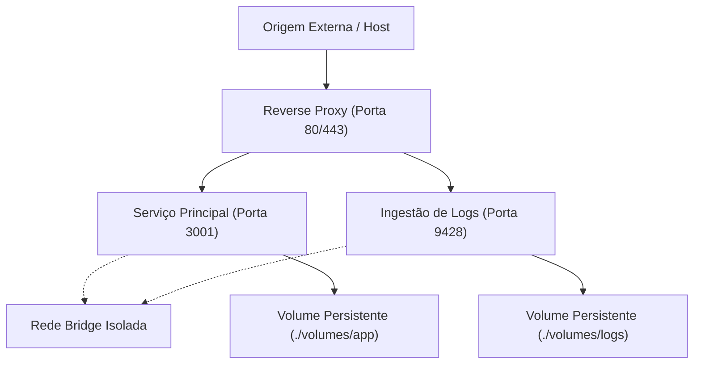

# Infra Starter Kit

Framework técnico para orquestração de serviços, Docker Compose e infraestrutura Homelab com agentes de IA.

**[English](README.md)** | **[Português (Brasil)](README.pt-br.md)**

[](https://github.com/ye-sandbox/template-agent/actions)
[]()
[](LICENSE)

---

## Visão Geral

O starter kit Infra fornece uma estrutura de governança de engenharia para agentes de codificação por IA (Antigravity, Claude Code, Cursor, Windsurf, Roo Code, Aider) gerenciarem e orquestrarem serviços de infraestrutura, stacks Docker Compose e ambientes Homelab (observabilidade, bancos de dados, brokers de mensagens, proxies reversos).

A atuação de agentes em infraestrutura introduz riscos críticos: colisão de portas, senhas em texto puro nos YAMLs, consumo descontrolado de memória e perda acidental de volumes de dados. O starter Infra mitiga esses riscos com:
- **Contrato de Topologia de Serviços:** Registro centralizado de portas de host, montagens de volume, redes e healthchecks em `.agent/SERVICES.md`.
- **Playbook Padronizado de Serviços:** Diretrizes reutilizáveis em `.agent/skills/compose-service/SKILL.md` impondo limites de recursos e execução como usuário não root.
- **Proteção de Volumes:** Armazenamento persistente mapeado em `./volumes` com regras estritas de gitignore e proteção contra exclusão acidental.
- **Isolamento de Segredos:** Substituição de ambiente via `.env.example` impedindo credenciais em texto puro no histórico Git.

## Arquitetura



### Estrutura de Diretórios

```text
├── AGENTS.md                    # Regras de ouro de SRE e guardrails de infraestrutura
├── init.sh                      # Script de scaffolding para novos repositórios de infra
├── compose.yaml.example         # Especificação canônica do Compose com healthchecks e limites
├── .env.example                 # Contrato de variáveis de ambiente e portas expostas
├── .gitignore                   # Proteção contra commit de volumes, dados e segredos
├── docs/
│   ├── README.md                # Índice de runbooks operacionais de infraestrutura
│   └── adr/decisions.md         # Registros consolidados de Decisões de Arquitetura
└── .agent/
    ├── SERVICES.md              # Topologia viva: Portas, Volumes, Redes e Healthchecks
    ├── TASK.md                  # Tarefa ativa e roadmap de evolução dos serviços
    ├── NOTES.md                 # Decisões de arquitetura e gotchas técnicos
    ├── ARCHIVE.md               # Histórico de tarefas concluídas
    ├── knowledge/               # Cards modulares de gotchas e armadilhas de runtime
    │   ├── 000-schema.md        # Especificação do schema de knowledge cards
    │   └── k-000-template.md    # Template para novos knowledge cards
    └── skills/
        └── compose-service/     # Procedimento padronizado para provisionamento
            └── SKILL.md         # Playbook passo a passo de serviços Compose
```

## Início Rápido

### Pré-requisitos

- Docker Engine 24.0+ e Docker Compose v2.20+
- Git 2.30+
- Bash 4.0+
- `curl` 7.60+

### Criando um Novo Repositório de Infraestrutura

Inicialize um novo repositório de infraestrutura via script automatizado:

```bash
curl -fsSL https://raw.githubusercontent.com/ye-sandbox/template-agent/infra/init.sh | bash -s -- meu-homelab
cd meu-homelab
```

*Alternativa via clone manual do Git:*

```bash
git clone --depth 1 -b infra https://github.com/ye-sandbox/template-agent.git meu-homelab
cd meu-homelab
rm -rf .git && git init -b main && git add . && git commit -m "chore: initial setup"
```

### Configuração e Execução Local

```bash
# 1. Configurar variáveis de ambiente
cp .env.example .env

# 2. Inicializar especificação do Compose a partir do exemplo canônico
cp compose.yaml.example compose.yaml

# 3. Validar sintaxe e variáveis interpoladas
docker compose config --quiet && echo "Compose sintaticamente válido!"

# 4. Iniciar serviços em modo desacoplado
docker compose up -d
docker compose ps
```

### Prompt Inicial

Envie este prompt ao seu agente de codificação durante o primeiro turno:

> "Leia AGENTS.md, .agent/SERVICES.md, .agent/TASK.md e a skill em .agent/skills/compose-service/SKILL.md. Apresente seu plano para a Tarefa [00.1] Provisionamento de Serviços Base antes de alterar arquivos de configuração."

## Configuração

O template fornece esquemas de configuração padronizados através do `.env.example`:

| Variável | Descrição | Padrão | Obrigatório |
| :--- | :--- | :--- | :--- |
| `TZ` | Fuso horário dos contêineres em execução | `America/Sao_Paulo` | Não |
| `DATA_PATH` | Caminho do diretório raiz no host para persistência de dados | `./volumes` | Sim |
| `VICTORIALOGS_PORT` | Porta de escuta do serviço de ingestão VictoriaLogs | `9428` | Não |
| `UPTIME_KUMA_PORT` | Porta de escuta do serviço de monitoramento Uptime Kuma | `3001` | Não |
| `REVERSE_PROXY_HTTP_PORT` | Porta de escuta HTTP para o proxy reverso de entrada | `80` | Não |
| `REVERSE_PROXY_HTTPS_PORT` | Porta de escuta HTTPS para o proxy reverso de entrada | `443` | Não |
| `ADMIN_PASSWORD` | Senha administrativa padrão do serviço | `change_this_password_in_production` | Sim (em produção) |
| `API_SECRET_TOKEN` | Token criptográfico para integração de serviços | `generate_a_random_token_here` | Sim (em produção) |

## Uso

### Invariantes de Infraestrutura e Regras Operacionais

1. **Topologia Primeiro:** Registre portas expostas, volumes e redes em `.agent/SERVICES.md` antes de editar `compose.yaml`.
2. **Healthchecks Obrigatórios:** Toda declaração de serviço deve conter healthcheck funcional (`test`, `interval`, `timeout`, `retries`).
3. **Limites de Recursos:** Defina limites explícitos de memória e CPU (`deploy.resources.limits`) em todos os serviços.
4. **Proteção de Dados:** Nunca execute `docker compose down -v` sem instrução explícita e confirmada por um humano.
5. **Higiene de Segredos:** Senhas, tokens e chaves privadas residem exclusivamente no `.env`.

## Desenvolvimento

### Comandos de Validação

```bash
# Validar sintaxe da configuração do Compose
docker compose config --quiet

# Verificar integridade de formatação e espaços em branco
git diff --check
```

## Licença

Distribuído sob a licença [MIT](LICENSE).
