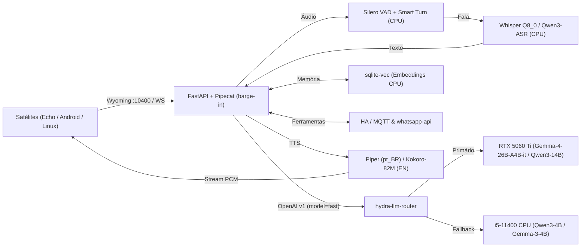

# offgrid-voice

Servidor de assistente de voz local-first, sem contenção de VRAM, construído com FastAPI, Pipecat e protocolo Wyoming para o homelab `ye-sandbox`.

**[English](README.md)** | **[Português (Brasil)](README.pt-br.md)**

[]()
[]()

---

## Visão Geral

O `offgrid-voice` executa todo o processamento de áudio (VAD, detecção de turno, STT, TTS) e memória vetorial em CPU (`0 MB` de contenção de VRAM na GPU) em um Mini PC `i5-11400` (`32 GB RAM`) 24/7, roteando a inferência LLM via [`hydra-llm-router`](.agent/ECOSYSTEM.md) (alias virtual `fast`) com failover automático de GPU para CPU.

- **Zero Contenção de VRAM:** `Silero VAD` + `Smart Turn`, `whisper-large-v3-turbo` (`Q8_0` / `INT8` AVX-512) ou `Qwen3-ASR-1.7B-gguf`, `Piper TTS` (`pt_BR-faber-medium`, latência `< 100ms`), `Kokoro-82M` e `sqlite-vec` (`bge-m3` / `Qwen3-Embedding-0.6B`) executam estritamente em CPU.
- **Failover Automático de LLM:** Consome `hydra-llm-router` (alias `fast`) respaldado por `local-llm-worker` (`RTX 5060 Ti 16 GB`: `Gemma-4-26B-A4B-it` / `Qwen3-14B`, thinking desabilitado) com fallback automático para CPU (`Qwen3-4B` / `Gemma-3-4B`) quando a workstation estiver ocupada ou desligada.
- **Ferramentas Modulares & Satélites:** Suporta `Wyoming` (`TCP :10400`) e WebSocket `FastAPI` (`/ws/voice`) com `barge-in` para satélites Echo desbloqueados (`amonet 2` / `Firebreak`), clientes Android Kiosk / Linux, `whatsapp-api` e Home Assistant / MQTT.

## Arquitetura

Consulte [docs/architecture/voice-pipeline.md](docs/architecture/voice-pipeline.md) para a especificação completa do pipeline.



## Início Rápido

Pré-requisitos: Python `3.12+` e `uv`.

```bash
cp .env.example .env
uv sync
uv run pytest
```

## Configuração

| Variável | Descrição | Padrão | Obrigatório |
| :--- | :--- | :--- | :--- |
| `APP_ENV` | Modo do ambiente de execução | `development` | Não |
| `APP_PORT` | Porta HTTP / WebSocket do FastAPI | `8000` | Não |
| `WYOMING_PORT` | Porta TCP do servidor Wyoming | `10400` | Não |
| `APP_SECRET_KEY` | Segredo de sessão da aplicação | `change-me-in-production` | Sim |
| `SQLITE_VEC_PATH` | Caminho do banco de memória `sqlite-vec` | `./data/offgrid_memory.db` | Não |
| `EMBEDDING_MODEL` | Modelo de embedding em CPU (`bge-m3` / `Qwen3-Embedding-0.6B`) | `Qwen3-Embedding-0.6B` | Não |
| `STT_MODEL` | Modelo STT em CPU (`whisper-large-v3-turbo` / `Qwen3-ASR-1.7B-gguf`) | `whisper-large-v3-turbo` | Não |
| `STT_QUANTIZATION` | Nível de quantização STT (`Q8_0` / `INT8`) | `Q8_0` | Não |
| `TTS_VOICE_PT_BR` | Modelo de voz Piper PT-BR | `pt_BR-faber-medium` | Não |
| `TTS_VOICE_EN` | Modelo TTS em Inglês | `kokoro-82m` | Não |
| `LLM_BASE_URL` | URL base OpenAI v1 do `hydra-llm-router` | `http://hydra-llm-router:3000/v1` | Sim |
| `LLM_API_KEY` | Chave de API de tier do Hydra | `sk-replace-with-hydra-tier-token` | Sim |
| `LLM_MODEL_FAST` | Alias virtual de baixa latência | `fast` | Não |
| `LLM_MODEL_DEEP` | Alias virtual de raciocínio profundo | `deep` | Não |
| `LLM_TIMEOUT_SECONDS` | Timeout do cliente HTTP em segundos | `180` | Não |
| `WHATSAPP_API_URL` | URL base da Gatekeeper `whatsapp-api` | `http://whatsapp-api:3000` | Não |
| `WHATSAPP_API_KEY` | Chave `x-api-key` para `whatsapp-api` | `replace-with-whatsapp-api-key` | Não |
| `MQTT_BROKER_URL` | URL do broker MQTT local | `mqtt://localhost:1883` | Não |
| `HA_URL` | URL base do Home Assistant | `http://homeassistant.local:8123` | Não |
| `HA_TOKEN` | Token de longa duração do Home Assistant | `replace-with-ha-long-lived-token` | Não |

## Uso

Endpoints e protocolos planejados para as Fases 1–2 (veja [.agent/TASK.md](.agent/TASK.md)):

- `GET /health` — Endpoint de healthcheck (logs de acesso HTTP 200 suprimidos).
- `TCP :10400` — Servidor de protocolo Wyoming para satélites de áudio.
- `WS /ws/voice` — Endpoint WebSocket de streaming para clientes `View Assist` / Android Kiosk.

## Desenvolvimento

```text
offgrid-voice/
├── .agent/                 # Governança, roadmap TASK.md, contratos NOTES.md, ECOSYSTEM.md
├── docs/
│   ├── adr/                # Diário de decisões arquiteturais (decisions.md)
│   └── architecture/       # Especificação do pipeline de voz (voice-pipeline.md)
├── .env.example            # Contrato de variáveis de ambiente
└── AGENTS.md               # Regras de engenharia e comandos de validação
```

Comandos de validação:

```bash
uv run pytest
uv run ruff check . && uv run ruff format --check .
uv run mypy src tests
git diff --check
```

## Licença

Privado / Interno (homelab `ye-sandbox`).
