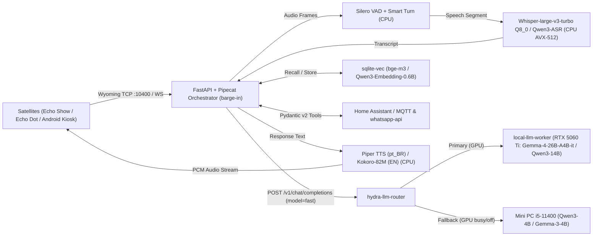

# Off-Grid Voice Assistant Architecture (`offgrid-voice`)

Canonical architecture specification for `offgrid-voice`, an off-grid, local-first voice assistant designed for the `ye-sandbox` homelab with **0 MB GPU VRAM contention**.

---

## 1. Design Invariant: 0 MB VRAM Contention

The workstation GPU (`RTX 5060 Ti 16 GB` managed by `local-llm-worker`) is shared with interactive coding and reasoning workloads (`--parallel 1`). To guarantee zero OOMs or latency spikes from model swapping:

- **All audio and memory workloads run 100% on CPU** on the 24/7 Mini PC (`Intel Core i5-11400`, `AVX-512`, `32 GB RAM`):
  - **VAD & Turn Detection:** `Silero VAD` + `Smart Turn` (`pipecat-ai/smart-turn`)
  - **STT:** `whisper-large-v3-turbo` (`INT8`/`Q8_0`) or `Qwen3-ASR-1.7B-gguf`
  - **TTS:** `Piper TTS` (`pt_BR-faber-medium`, `< 100ms` latency) + `Kokoro-82M` (EN)
  - **Vector Memory:** `sqlite-vec` with CPU embeddings (`bge-m3` / `Qwen3-Embedding-0.6B`)
- **LLM inference is decoupled via `hydra-llm-router`**, using the `fast` virtual model alias with automatic GPU-to-CPU failover.

---

## 2. End-to-End Voice Pipeline

---

## 3. Layer Breakdown

### A. Satellites & Ingress
- **Primary Targets (Phase 3):**
  - **Echo Show 5 / 8:** Jailbroken via `amonet 2` + LineageOS + `View Assist` (WebSocket + visual cards).
  - **Echo Dot 2 / 3:** Jailbroken via `Firebreak` + Wyoming bridge (`TCP :10400`).
  - *Invariant:* Hardware board and bootloader revisions MUST be verified before purchasing units.
- **Validation Fallback (Phase 1 & 2):**
  - Android Kiosk client and/or Linux Wyoming CLI client for end-to-end pipeline testing before hardware acquisition.

### B. Protocol, Orchestration & Barge-In
- **Server:** `FastAPI` + `Wyoming` protocol listener + `Pipecat` streaming pipeline.
- **VAD & Turn Detection:** `Silero VAD` detects speech onset/offset; `Smart Turn` (`pipecat-ai/smart-turn`) predicts semantic end-of-turn so natural pauses do not prematurely trigger LLM calls.
- **Barge-In:** Incoming `Silero VAD` speech onset during TTS playback immediately cancels the active TTS stream and flushes the satellite audio buffer.

### C. Speech-to-Text (CPU / 0 MB VRAM)
- **Primary:** `whisper-large-v3-turbo` quantized (`INT8` / `Q8_0`) running on `i5-11400` AVX-512 CPU.
- **Alternative:** `Qwen3-ASR-1.7B-gguf` for bilingual PT-BR + EN accuracy.

### D. LLM Routing & Automatic Failover
- **Gateway:** `hydra-llm-router` (`http://hydra-llm-router:3000/v1` on `hydra_shared_net` or `https://hydra-router.homelab.yegear.dev/v1`).
- **Virtual Model Alias:** `fast` (OpenAI v1 + SSE streaming + tool calling).
- **Primary Backend:** `local-llm-worker` on workstation `RTX 5060 Ti 16 GB` (`Gemma-4-26B-A4B-it` / `Qwen3-14B` with thinking disabled for low-latency voice turn-taking).
- **Automatic Fallback:** Mini PC `i5-11400` CPU (`Qwen3-4B` / `Gemma-3-4B`) automatically serves `fast` requests when the GPU workstation is occupied by `--parallel 1` coding jobs or powered off.

### E. Text-to-Speech (CPU / 0 MB VRAM)
- **PT-BR:** `Piper TTS` (`pt_BR-faber-medium`) targeting `< 100ms` first-audio latency on CPU.
- **EN:** `Kokoro-82M` on CPU.

### F. Memory & Modular Tool Registry
- **Semantic Memory:** `sqlite-vec` persisted locally on the 24/7 Mini PC (`32 GB RAM`), indexed with CPU-based `bge-m3` or `Qwen3-Embedding-0.6B` embeddings.
- **Tools (`Pydantic v2`):**
  - **Home Assistant / MQTT:** Local device state queries and service calls.
  - **Homelab Status:** Container/service health and host vitals summaries.
  - **WhatsApp (`whatsapp-api`):** Outbound messages via Gatekeeper `POST /send` / Redis queue (`x-api-key`).

---

## 4. Phased Delivery Roadmap

1. **Phase 1 — Core Server:** FastAPI + Pipecat + Wyoming + Silero VAD + Smart Turn + Whisper CPU + Hydra `fast` + Piper TTS, validated with local Linux/Android client.
2. **Phase 2 — Tools & Memory:** `Pydantic v2` tool registry (Home Assistant/MQTT, Homelab status, `whatsapp-api`) + `sqlite-vec` memory.
3. **Phase 3 — Hardware Acquisition & Jailbreak:** Verify board/bootloader revisions; deploy `amonet 2` / `Firebreak` on Echo satellites.
4. **Phase 4 — 24/7 HA & CPU Fallback:** Productionize 24/7 Mini PC `i5-11400` deployment and validate seamless GPU-to-CPU fallback.
